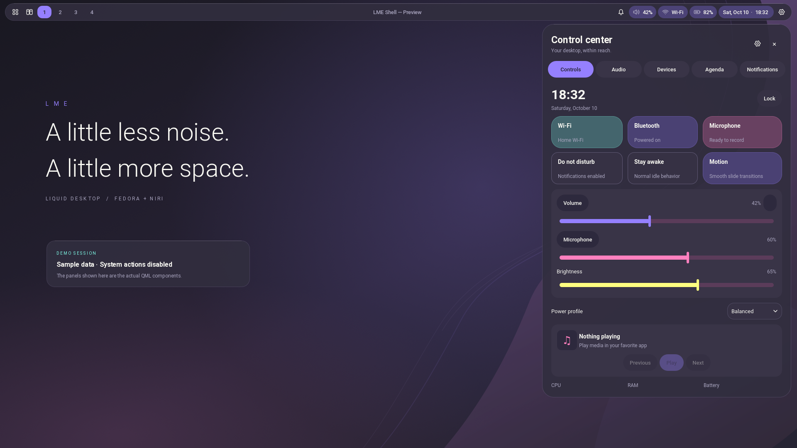
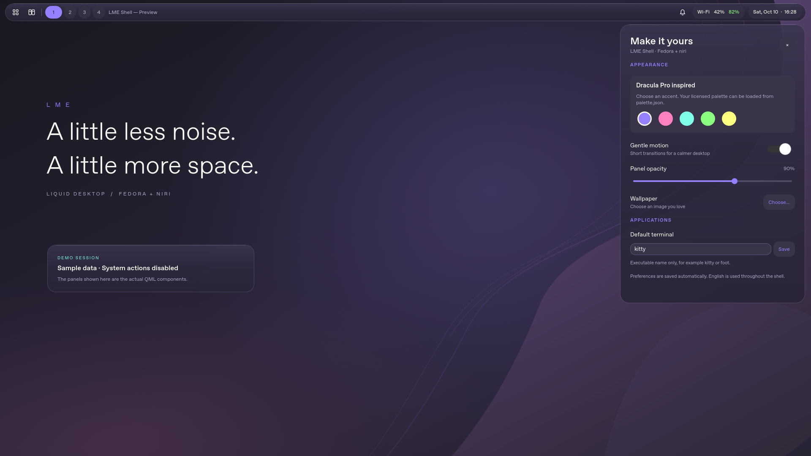

# LME Shell

A Quickshell desktop shell for **Fedora 44 + niri**, written in QML/Qt Quick
with a small Python standard-library backend. All interface text, code, and
documentation are in English.

The layout combines a compact top bar and a control sidebar on the right.
Its Material 3 Expressive inspired controls sit on Liquid glass surfaces, with a
dark Dracula Pro-style palette, flat tonal fills, Roboto typography, rounded
shapes, and eased slide animations suitable
for an integrated Radeon GPU.

The interaction design takes inspiration from
[end-4/dots-hyprland](https://github.com/end-4/dots-hyprland) and
[snowarch/iNiR](https://github.com/snowarch/iNiR). This is a separate
niri implementation; it uses niri IPC and Fedora utilities rather than Hyprland
commands or Arch installation scripts.



## Included

- Modular per-output top bar: 15 modules, three configurable zones, drag/drop
  and keyboard ordering, optional media/resources, and live layout changes.
  The default is one connected glass pill; three islands are also available.
  Workspaces follow their numeric order per output. Bar labels use consistent
  Roboto Medium, adjustable from 12 to 16 px.
- Overview button for niri's live window previews and drag/drop. Right-click it
  for a themed workspace board with app icons, titles, drag/drop and a keyboard
  workspace selector for each window.
- System tray dropdown with compact icons, application labels, and native menus.
- Local text/image clipboard history: search, previews, pins, pause and confirmed
  clearing. Open with Super+V; requires `wl-clipboard`.
- Expanding Activity island with MPRIS controls, shared focus timer/stopwatch and
  supported recorder status; eased resizing with flat glass surfaces. See
  [clipboard and Activity setup](docs/CLIPBOARD_ACTIVITY.md).
- Smart launcher with fuzzy app search, favorites, arithmetic, emoji and open-window search.
- Wider control center with Controls, Audio, Devices, Agenda and Notifications
  tabs, saved draggable tiles/cards and full/half sizes: speaker/microphone volume and mute, backlight, radios, power profiles,
  idle inhibition, Night Light, motion, Screenshot studio and system information.
- Night Light with manual, local-time and sunset schedules using `wlsunset`.
- Screenshot studio: native niri capture, Pen/Highlight/Rectangle/Arrow/Redact,
  undo/redo, zoom, original-resolution PNG export, image copy and local OCR.
- Smooth/Expressive/Jelly motion presets, adjustable speed/bounce, reduced motion
  and Appearance profile integration. See [setup and usage](docs/CAPTURE_NIGHT_MOTION.md).
- Native PipeWire device selection and individual device/application sliders;
  Bluetooth adapter selection, paired-device connect/disconnect and rfkill
  diagnostics, plus Wi-Fi scanning, password entry and saved-network management.
- Automatic local weather by approximate IP location, current conditions and
  a three-day forecast; city search, manual location and °C/°F in Settings.
- Lenovo charging controls: verified 85%/100% thresholds when exposed, with
  firmware conservation mode as the fallback. See [charging setup](docs/CHARGING.md).
- Built-in Polkit authentication popup: password entry, retry and cancellation
  work when the shell starts from niri without a terminal. See [authentication](docs/AUTHENTICATION.md).
- Wallpaper folder library, thumbnails, search and favorites through `awww`, with automatic daemon startup.
- English calendar, saved to-do list, focus timer and stopwatch.
- MPRIS media controls for compatible players and an English date/time display.
- Native notifications with persistent, searchable app groups, per-app popup rules and timed Do Not Disturb.
- Independent Settings application with searchable Appearance, Top bar,
  Control center, Displays, Wallpaper, Weather, Clipboard, Idle and sleep, Keyboard shortcuts, Behavior and About pages. Open it without starting the shell.
  Changes synchronize with the running shell; preferences are merged under a
  file lock so another client’s task updates are preserved.
- On-demand system monitor: CPU/RAM charts, CPU thread loads/temperature, network rates and sortable searchable processes without GPU probes.
- Separate AC/battery idle profiles, display wake on input and a confirmed session lock before suspend; searchable niri keybindings with include support.
- Optional full-screen popup blur on niri 26.04+, including the expanded Activity Island; see [laptop features and blur setup](docs/LAPTOP_FEATURES.md).
- Saved appearance profiles and safe niri display previews with independent automatic revert.
- Material tonal surfaces, expressive switches/sliders and shape transitions,
  bold Roboto headings, and translucent glass without UI gradients.
- Lock, suspend, logout, restart, and shutdown actions with confirmation for
  destructive actions.
- Optional original wallpaper, package requirements, installation scripts,
  niri bindings, and troubleshooting documentation.

First-time Bluetooth pairing, enterprise Wi-Fi setup and advanced audio configuration open the existing Fedora
tools (`nm-connection-editor`, `blueman-manager`, and `pavucontrol`). The shell
does not implement a password manager or replace NetworkManager.

## Install

The target machine already has niri installed. Check the package requirements
and installation details in [docs/INSTALL.md](docs/INSTALL.md).

```bash
git clone https://github.com/longme179/lme-fedora-niri-qs.git
cd lme-fedora-niri-qs

# Show packages first. This command changes nothing.
./scripts/install-fedora.sh --optional

# On Fedora: install packages from enabled repositories.
./scripts/install-fedora.sh --install --optional

# Link this checkout into the current user's Quickshell config.
./scripts/install.sh

# Register the separate settings app in the application launcher.
./scripts/install-settings.sh

# Run inside a niri Wayland session.
./scripts/start.sh
```

If Quickshell is absent from enabled repositories, the installer stops and
explains the upstream-documented COPR option. It never adds a repository silently.
Keep the checkout in place: the installation is a symlink to this directory.
Install both `awww` and `awww-daemon` for wallpaper support; see
[the upstream and Fedora instructions](docs/INSTALL.md#wallpaper-and-charging).
Charging needs a one-time local helper installation:

```bash
sudo ./scripts/install-charge-helper.sh --install
```

The shell stays unprivileged; Polkit requests administrator authentication when
needed. A fixed firmware conservation limit cannot be changed to exactly 85%.
Weather uses HTTPS services with no API key or extra Python packages.

Merge [config/niri/lme-shell.kdl](config/niri/lme-shell.kdl) into your existing
niri configuration after checking for duplicate bindings. The installer never
overwrites `~/.config/niri/config.kdl`.

| Shortcut | Action |
| --- | --- |
| `Mod+Tab` | niri live overview |
| `Mod+Shift+Tab` | Shell workspace board |
| `Mod+Space` | Application launcher |
| `Mod+A` | Control center |
| `Mod+N` | Notifications |
| `Mod+V` | Clipboard history |
| `Mod+Shift+A` | Activity island |
| `Mod+Comma` | Separate Settings app |
| `Mod+Shift+E` | Power menu |
| `Escape` | Close an open panel |

`Mod` is normally Super/Windows in a normal niri session. `Mod+Comma` and
`Mod+Shift+E` have other meanings in niri's sample configuration; remove or
rebind the existing entries before adding these bindings.

The expanded shell requires **Quickshell 0.3.2+** with PipeWire and Wayland
support, and **niri 25.11+**. The overview's live thumbnails are rendered by niri;
the QML board lists windows with their titles and icons. See
[docs/CONFIGURATION.md](docs/CONFIGURATION.md) for all control-center features.

## Configuration and validation

User preferences live in `~/.config/lme-shell/settings.json`, separate from the
checkout. Palette overrides live in `~/.config/lme-shell/palette.json`. See
[docs/CONFIGURATION.md](docs/CONFIGURATION.md).

```bash
# Check tools and session connectivity without changing system state.
./scripts/doctor.sh

# Preview with sample data; desktop actions and saved settings are disabled.
./scripts/start.sh --preview

# A read-only snapshot of real integration state.
python3 scripts/desktop_backend.py --once
```

The implementation is designed for the Lenovo IdeaPad Gaming 3 15ARH7 with
Ryzen 5 7535HS, integrated Radeon graphics, RTX 4050 Laptop, 16 GB RAM, and a
1920×1080 120 Hz panel. Real hardware validation still belongs on that laptop;
cloud tests cannot establish graphics, backlight, radio, or suspend behavior.
The shell does not install graphics drivers or change disk partitions.

The default glass effect is transparency with highlights. Background blur
depends on compositor support and is not required to run this shell. No
continuous GPU blur shader or discrete-GPU requirement is introduced.

Run `./scripts/check.sh` for the backend test suite and shell-script checks.

See [docs/TROUBLESHOOTING.md](docs/TROUBLESHOOTING.md) for session issues and
[docs/VALIDATION.md](docs/VALIDATION.md) for what can be checked in cloud and
what needs a real Fedora desktop session.

Preview images are stored in [docs/previews](docs/previews). They were rendered
from the actual QML with sample state or native-service test fixtures. Their
captions identify the inputs; they are not screenshots from the user's Fedora
laptop.

## Project layout

```text
shell.qml                   Quickshell entry point and panel IPC
qml/                        Components, panels, and shared services
scripts/desktop_backend.py  Desktop commands and live state; Python stdlib only
scripts/install-fedora.sh   Preview/install Fedora packages
scripts/install.sh          Safe user-config symlink installation
scripts/start.sh            Startup and optional wallpaper restoration
scripts/doctor.sh           Read-only environment checks
config/niri/                Configuration fragment; never applied automatically
assets/wallpapers/          Original wallpaper source and raster image
docs/                       Installation, settings, troubleshooting, validation
requirements-fedora.txt     Required and optional DNF packages
```

Licensed under **GPL-3.0-or-later**. See [LICENSE](LICENSE) and
[THIRD_PARTY.md](THIRD_PARTY.md) for upstream attribution and asset provenance.

## Personalize

Open **LME Shell Settings** from your launcher or run:

```bash
./scripts/settings.sh
./scripts/settings.sh --page topbar
./scripts/settings.sh --demo
```

Settings uses its own window and can run while the desktop shell is stopped.
The demo uses a separate entry point and never saves preferences or applies a
wallpaper. **Weather** controls automatic location, city search and units.
**Top bar** lets you move modules between Left, Center and Right,
reorder with a drag grip or arrow buttons, add/remove modules, change the shape,
and adjust text size. Restore default layout resets the module arrangement only.



See [docs/INIR_PORT.md](docs/INIR_PORT.md) for the iNiR feature mapping and the
Material/glass design choices. The required Fedora font package is
`google-roboto-fonts`; no fonts or upstream artwork are bundled.

The seven desktop upgrades—appearance profiles, display previews with automatic
revert, persistent grouped notifications, wallpaper browsing, modular controls,
smart launcher and in-shell Wi-Fi—are documented in
[Desktop upgrades](docs/DESKTOP_UPGRADES.md). Screenshots: [profiles](docs/previews/appearance-profiles.png),
[displays](docs/previews/display-settings.png), [wallpaper library](docs/previews/wallpaper-library.png),
[modular controls](docs/previews/control-layout.png), [notifications](docs/previews/notifications-grouped.png)
[Wi-Fi](docs/previews/wifi-connections.png) and [launcher](docs/previews/smart-launcher.png).

Latest laptop previews: [system monitor](docs/previews/system-monitor.png), [idle profiles](docs/previews/idle-profiles.png), [keybindings](docs/previews/keybind-viewer.png). Setup and limits: [docs/LAPTOP_FEATURES.md](docs/LAPTOP_FEATURES.md).

Night Light, Screenshot studio and customizable motion are documented in
[Capture, Night Light and motion](docs/CAPTURE_NIGHT_MOTION.md). Actual QML previews:
[Night Light](docs/previews/night-light.png), [motion presets](docs/previews/motion-presets.png)
and [Screenshot studio](docs/previews/screenshot-studio.png).
