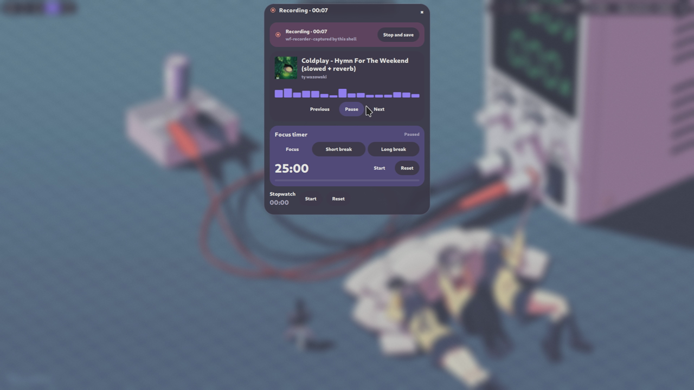
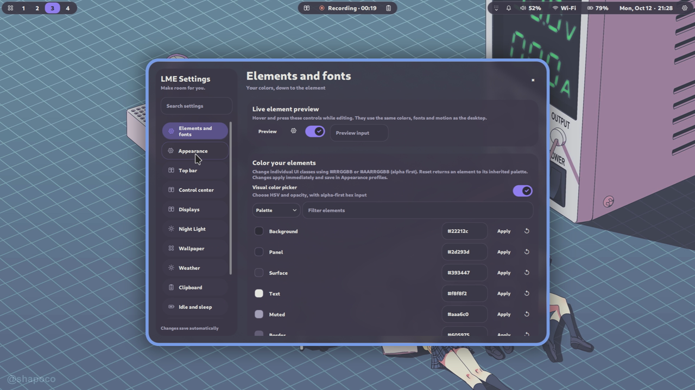

<h1 align="center">LME Shell</h1>

<p align="center"><strong>Material 3 Expressive meets liquid glass.<br>A personal desktop shell for Fedora and niri.</strong></p>

<p align="center">
  
  
  
</p>

<p align="center">
  <a href="#installation">Install</a> · <a href="#features">Features</a> · <a href="#make-it-yours">Personalize</a> · <a href="#documentation">Documentation</a> · <a href="CHANGELOG.md">Changelog</a>
</p>

[](https://www.dropbox.com/scl/fi/k49ecqpegw4wugxeti9e5/Recording-20261012-212816-b_ljs2h1.mp4?rlkey=wheqf766q9nw2u6eyljpr8qs6&st=cxkenwuw&dl=0)

**[▶ Watch the demo](https://www.dropbox.com/scl/fi/k49ecqpegw4wugxeti9e5/Recording-20261012-212816-b_ljs2h1.mp4?rlkey=wheqf766q9nw2u6eyljpr8qs6&st=cxkenwuw&dl=0)** · [Download the original MP4](https://www.dropbox.com/scl/fi/k49ecqpegw4wugxeti9e5/Recording-20261012-212816-b_ljs2h1.mp4?rlkey=wheqf766q9nw2u6eyljpr8qs6&st=cxkenwuw&dl=1)

The preview comes from the maintainer's recording, with a customized layout.
Click it to watch the 65-second demo in Dropbox; the original 1080p MP4 is also
available through the original MP4 link above.

LME is built with **Quickshell and QML/Qt Quick**. A modular bar, an expandable
Activity island and a standalone Settings app put everyday desktop controls
within reach. Rounded shapes, springs that keep their velocity, translucent
glass, Dracula-inspired colors and Roboto typography carry through the interface.
The UI, source and documentation are in English.

First run uses one connected top bar, a centered Activity island and a Control
Center on the right. Choose your own modules, colors, fonts, spacing and motion
without editing QML.

## Features

| Your desktop | What LME brings |
| --- | --- |
| **A bar you can arrange** | Enable, reorder and move modules; choose connected or separate pills, top/bottom placement and edge distances. Ordered workspaces and a tray dropdown keep the bar compact. |
| **An Activity island** | Expand media controls, focus/break timer, stopwatch and owned recording controls. Real Cava spectrum follows playback. |
| **A modular Control Center** | Drag independent toggles, actions and sliders on a scrolling canvas. Power/Settings use 1×1 cells; power profiles cycle in 2×1; volume, microphone and brightness each use 4×1. Hide buttons independently and arrange detailed cards. |
| **A useful launcher** | Fuzzy app search, favorites, calculator, emoji, open windows and bounded file/folder search. |
| **Everyday tools** | Clipboard text/images with search and pins; grouped, persistent notifications; timed DND; calendar, tasks and autosaved notes. |
| **Laptop controls** | Weather with automatic or manual location, supported Lenovo charging modes, AC/battery idle profiles, system monitoring and display settings with automatic revert. |
| **Capture and comfort** | Start/stop output or region recording, screenshot drawing/redaction, external Satty/Swappy annotation, local OCR and scheduled Night Light. |
| **Topbar styling** | Connected bar plus independently styled Left/Center/Right islands; corner roundness, square-left/right presets, border thickness and alpha/hex fill/color. Settings → Top bar applies changes live and includes them in settings exports. |
| **Personal appearance** | Per-element hex colors and fonts, searchable font menus, HSV/alpha color picker, appearance profiles, 35 Gowall palette presets plus LME Dracula, and Material wallpaper palettes with scheme, light/dark and contrast controls. |

**Recording:** NVIDIA-first recording with iGPU/CPU fallback, MKV/MP4/MOV/WebM
and encoding controls, external screenshot annotation, workspace selection
without a redundant monitor-centering action, and a more responsive audio
spectrum. See the [changelog](CHANGELOG.md) for the feature history.

## Installation

### Requirements

The supported target is **Fedora 44 with an existing niri Wayland session**.
Use **niri 26.04+** for recording and native popup blur; basic shell integration
supports niri 25.11+. LME supplies the desktop interface; niri manages windows.

| Requirement | Purpose |
| --- | --- |
| Quickshell **0.3.2+** | Runs the shell; its build needs PipeWire, Polkit and Wayland/BackgroundEffect support |
| Matching Qt 6 runtime | Qt Quick, Wayland, SVG and image support |
| Python 3 | Desktop integration using the standard library |
| Roboto and Noto fonts | UI typography, fallback characters and emoji |
| Fedora desktop services | NetworkManager, BlueZ, PipeWire/WirePlumber and an existing power-profile provider |

[requirements-fedora.txt](requirements-fedora.txt) groups packages by purpose.
It is a **DNF package list**, not a pip requirements file. The package helper
assumes niri is already installed and does not change GPU drivers or partitions.

### 1. Keep a permanent checkout

Install Git with `sudo dnf install git` if needed, then run:

```bash
mkdir -p ~/src
git clone https://github.com/longme179/lme-fedora-niri-qs.git ~/src/lme-fedora-niri-qs
cd ~/src/lme-fedora-niri-qs
```

This checkout tracks `main`. You can also use GitHub’s **Code → Download ZIP**
and extract it into a permanent directory. Run the following commands from
that source directory, and keep it after installation: the installed shell
links to it. The maintainer decides when to publish releases; no versioned
release download is required for this installation path.

### 2. Review and install packages

Run these as your normal desktop user, inside Fedora:

```bash
# Preview the proposed DNF command; no packages are installed.
./scripts/install-fedora.sh --optional

# Install required and recommended packages; DNF asks before its transaction.
./scripts/install-fedora.sh --install --optional
```

`--optional` includes tools for locking, idle profiles, OCR, Night Light,
recording, audio spectrum and external annotation, plus recommended applications.
Keep your working TuneD/tuned-ppd or power-profiles-daemon provider.

<details>
<summary><strong>Quickshell is missing from my enabled repositories</strong></summary>

Review the [errornointernet/quickshell COPR](https://copr.fedorainfracloud.org/coprs/errornointernet/quickshell/)
and its Fedora 44 build. This flag allows the installer to enable that source
only when Quickshell is unavailable:

```bash
./scripts/install-fedora.sh --install --optional --copr
```

Package signatures and TLS checks stay enabled. See the
[repository availability guide](docs/INSTALL.md#quickshell-repository-availability).

</details>

### 3. Link the shell, add Settings and try it

```bash
./scripts/install.sh
./scripts/install-settings.sh
./scripts/doctor.sh
./scripts/start.sh
```

| Command | What it does |
| --- | --- |
| `install.sh` | Links `~/.config/quickshell/lme-shell` to this source directory |
| `install-settings.sh` | Adds **LME Shell Settings** to the application launcher |
| `doctor.sh` | Reports missing tools and session integration without changing system state |
| `start.sh` | Restores saved wallpaper/confirmed display settings and starts Quickshell |

The two install scripts support `--dry-run`. If an existing target needs
replacement, `--replace` preserves it in a backup. Your niri configuration and
saved preferences stay separate. Keep the terminal open while testing; Ctrl+C
stops this shell instance.

To explore a windowed demo with sample data and no saved changes or desktop
actions, use `./scripts/start.sh --preview`.

### 4. Integrate with niri

Review [the integration fragment](config/niri/lme-shell.kdl), then add this to
`~/.config/niri/config.kdl` for the default installation:

```kdl
include "~/.config/quickshell/lme-shell/config/niri/lme-shell.kdl"
```

It starts LME at login, supplies its shortcuts and opens Settings/Screenshot
studio as floating windows. Remove or rebind conflicting keys before including
it, especially `Mod+Comma` and `Mod+Shift+E` from niri's sample config. Keep one
shell startup entry and one notification server/Polkit agent in your session.
LME includes its own notification server and password popup.

For **live blur behind popups** on niri 26.04+, also add:

```kdl
include "~/.config/quickshell/lme-shell/config/niri/popup-blur.kdl"
```

Enable **Settings → Appearance → Blur behind popups**, then validate:

```bash
niri validate
```

Merge any existing `blur` block instead of defining it twice. The supplied rule
uses `xray false`, keeping live applications beneath the blur. The dim layer
animates; native blur intensity is region-based and does not interpolate.
[More about capture, blur and motion](docs/CAPTURE_NIGHT_MOTION.md).

## Make it yours

Open Settings from either gear button, the application launcher, **Super+Comma**,
or `./scripts/settings.sh`. It runs in its own window and shares saved preferences
with the shell, even when the shell is stopped.



| Page | Customize |
| --- | --- |
| **Appearance** | Accent, glass opacity, density, profiles, spring/morph motion, Smooth/Expressive/Jelly presets and popup blur |
| **Elements and fonts** | Individual color roles, hex input, HSV/alpha picker, installed fonts and text size |
| **Top bar / Control center** | Module/card order, visibility, sizes, bar position/margins and panel width |
| **Displays / Idle and sleep** | Resolution, refresh, scale and output placement; AC/battery timeouts, locking and suspend |
| **Wallpaper / Weather** | Image library, favorites, palette preview, automatic/manual location and units |
| **Behavior** | Privacy, OSD position/layout/output, notes, file search, recording, external editor and settings transfer |
| **Keyboard shortcuts / Clipboard** | Search niri bindings; configure history and image capture |

Jump to a page with `./scripts/settings.sh --page topbar`. Use
`./scripts/settings.sh --demo` for a Settings preview without saving changes.

Preferences live in `~/.config/lme-shell/settings.json`, separate from the
Quickshell source. Updates preserve them; saved choices override factory defaults.
If you set `XDG_CONFIG_HOME`, use that directory instead of `~/.config`.
Automatic idle management and Night Light start disabled.

**Share a preset:** use **Behavior → Settings export and restore → Export preset**.
Send this portable JSON when proposing factory settings; it excludes personal
paths, location, device IDs and tasks. Import validates fields and backs up
current settings. Private backups include personal settings and should stay
private. Clipboard/notification history and notes are separate from settings
backups. [Configuration guide](docs/CONFIGURATION.md).

## Optional integrations

| Feature | What to install or configure |
| --- | --- |
| **Wallpaper** | Install `awww` **and** `awww-daemon` from a trusted available source; the package helper does not install them. [Setup](docs/INSTALL.md#wallpaper-and-charging) · [Upstream](https://codeberg.org/LGFae/awww) |
| **Material palette / Audio spectrum** | `matugen` / `cava`. Cava runs for visible, playing media cards, with 60 fps and reduced smoothing. |
| **External display mirroring** | `wl-mirror` (Fedora: `sudo dnf install wl-mirror`). Connect and enable both outputs, then use Settings → Displays or Control Center → Devices. Choose Source/Destination and Start mirror; Stop closes only LME’s mirror window. [Setup and hardware checks](docs/MIRRORING.md). |
| **Recording** | `wf-recorder`, compatible FFmpeg/`ffprobe`; `pulseaudio-utils` for audio and `slurp` for regions. Auto tries NVIDIA NVENC → integrated VAAPI → CPU, probing only when capture starts. Chosen codecs depend on your driver/build. |
| **External annotation / OCR** | Fedora `swappy`, or separately installed Satty; `tesseract` and language packs for local OCR. External editors receive a saved, flattened PNG including redactions. |
| **Night Light / Idle** | `wlsunset` with working gamma control; `swayidle` and `swaylock` for idle profiles. Enable these in Settings. |
| **Weather** | Internet access for Open-Meteo and approximate IP location; no API key needed. Manual location is available. |
| **Lenovo charging** | Install the helper with `sudo ./scripts/install-charge-helper.sh --install`. Adjustable thresholds depend on firmware; some machines expose only a fixed conservation mode. [Charging guide](docs/CHARGING.md) |

The optional package set includes most tools above. `ffmpeg-free` may omit NVENC
or other chosen codecs; a working GPU driver and compatible encoder build are
required. LME does not install or replace GPU drivers. Recording format, codec,
FPS, bitrate and fallback details are in [the feature guide](docs/FEATURE_PORTS.md).

## Shortcuts

Active after including the niri fragment. `Mod` normally means **Super/Windows**.

| Shortcut | Action |
| --- | --- |
| `Mod+Space` | Application launcher |
| `Mod+A` | Control Center |
| `Mod+Comma` | Settings |
| `Mod+Tab` / `Mod+Shift+Tab` | niri live overview / themed workspace board |
| `Mod+N` / `Mod+V` | Notification history / clipboard history |
| `Mod+Shift+A` | Activity island |
| `Mod+Shift+E` | Power menu |
| `Escape` | Close an open shell panel |

The bar's Overview button opens niri's live overview; right-click opens the
workspace board. The Settings keybind viewer reads your niri config and includes.

## Updates

For a Git checkout tracking `main`, run from the permanent source directory:

```bash
git pull --ff-only
quickshell -c lme-shell kill
./scripts/start.sh
```

The symlink uses the updated source. Reopen Settings too; rerun the package
preview/install if new dependencies are needed. For a release ZIP installation,
extract the new version to a permanent directory and rerun both install scripts
with `--replace` to update their targets while keeping backups.

<details>
<summary><strong>I use a configuration named gpt</strong></summary>

Keep the checkout outside `~/.config/quickshell/gpt`, then link it and start with
that configuration name:

```bash
./scripts/install.sh --replace --target "${XDG_CONFIG_HOME:-$HOME/.config}/quickshell/gpt"
./scripts/install-settings.sh --replace
./scripts/start.sh --config gpt
```

Replace `lme-shell` with `gpt` in niri includes, startup and IPC bindings. The
supplied fragment targets `lme-shell` by default, so adapt it before inclusion.
To restart this instance, use `quickshell -c gpt kill` and
`./scripts/start.sh --config gpt`. Preferences still use `lme-shell/settings.json`.

</details>

## Documentation

| Guide | Covers |
| --- | --- |
| [Installation](docs/INSTALL.md) | Fedora packages, sources, niri setup, custom paths and services |
| [Configuration](docs/CONFIGURATION.md) / [Personalization](docs/PERSONALIZATION.md) | Preferences, profiles, colors, typography, geometry and liquid feedback |
| [Selected feature ports](docs/FEATURE_PORTS.md) | Detailed controls, dependencies, tests and hardware limits |
| [Capture, Night Light and motion](docs/CAPTURE_NIGHT_MOTION.md) | Screenshot drawing/redaction/OCR, external annotation, schedules and animations |
| [Laptop features](docs/LAPTOP_FEATURES.md) | System monitor, idle profiles, keybindings and native blur |
| [Clipboard and Activity](docs/CLIPBOARD_ACTIVITY.md) | History, pins, timers, media and recording status |
| [Charging](docs/CHARGING.md) / [Authentication](docs/AUTHENTICATION.md) | Firmware support, helper setup and password prompts |
| [Troubleshooting](docs/TROUBLESHOOTING.md) / [Validation](docs/VALIDATION.md) | Diagnosis, development checks and what has been tested |

## Help and development

Run `./scripts/doctor.sh` first. For Settings startup errors, run
`./scripts/settings.sh --page appearance` in a terminal and confirm you updated
the installed configuration. For wallpaper-only blur, check the blur include and
`xray false`. For pointer movement, remove an enabled `warp-mouse-to-focus` rule
if unwanted; niri owns that policy.

[Report a problem](https://github.com/longme179/lme-fedora-niri-qs/issues) with
reproduction steps, logs, doctor output, `niri --version` and `qs --version`.
First-time Bluetooth pairing and enterprise Wi-Fi use Fedora's existing tools;
Control Center links to Blueman and the network editor.

Run `./scripts/check.sh` for backend regressions, script syntax and demo state.
Native UI checks require a private Wayland session. See [validation details](docs/VALIDATION.md)
for the executed checks and hardware limits. These checks do not certify every
GPU, radio, display or suspend path.

## Credits and license

Inspired by [end-4/dots-hyprland](https://github.com/end-4/dots-hyprland),
[iNiR](https://github.com/snowarch/iNiR),
[DankMaterialShell](https://github.com/AvengeMedia/DankMaterialShell),
[Caelestia](https://github.com/caelestia-dots/shell) and
[Noctalia](https://github.com/noctalia-dev/noctalia).

**Based on iNiR by snowarch (https://github.com/snowarch/inir)**. Upstream morph
geometry and recording workflow adaptations are modified for LME; copyright,
licenses and the iNiR notice are retained.

LME's original code is **GPL-3.0-or-later**, with retained GPL-3.0-only terms in
adapted upstream components. See [LICENSE](LICENSE), [THIRD_PARTY.md](THIRD_PARTY.md)
and `third_party/` for attribution and licensing. Purchased Dracula Pro assets
and fonts are not bundled. The demo recording was supplied by the maintainer;
its wallpaper/artwork remains credited to its respective creators.
