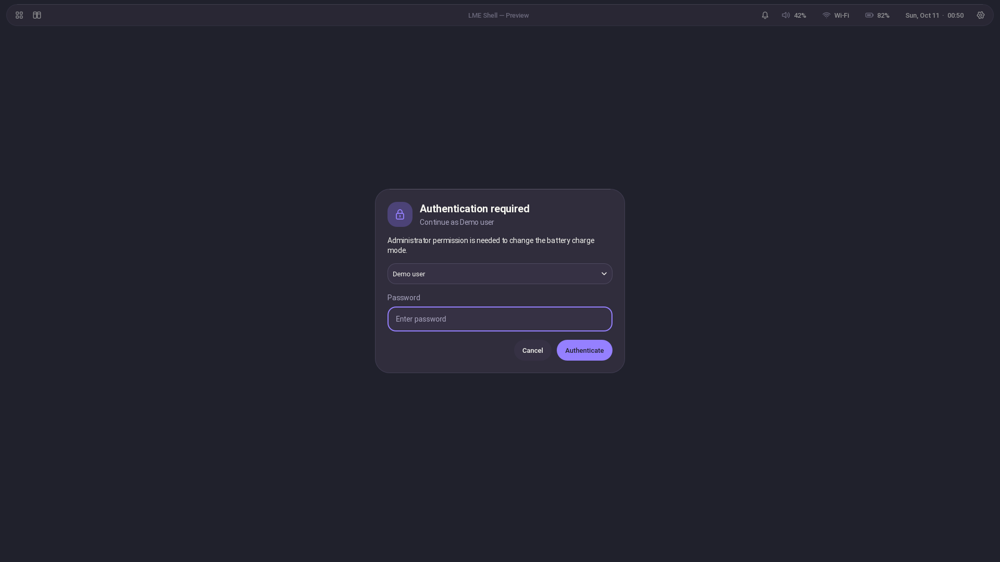

# Authentication popup

LME Shell registers Quickshell's native Polkit agent in the current desktop
session. When an action needs administrator authentication, a centered glass
popup asks for the indicated account's password. This works with
`quickshell -c lme-shell`, the `qs` alias, a renamed configuration such as
`qs -c gpt`, and niri's startup entry. The start wrapper is not required for
authentication.



The popup also receives Polkit requests from other applications in the same
session. It follows the system's existing authorization policy; actions already
authorized by that policy may run without a prompt.

## Requirements and updating

- Quickshell **0.3.2 or newer**, built with `Quickshell.Services.Polkit`.
  For a custom source build, enable **`SERVICE_POLKIT=ON`**. On Fedora, the
  corresponding build dependencies include `polkit-devel`, `glib2-devel` and
  `pkgconf-pkg-config`, in addition to upstream's usual Qt dependencies.
- Fedora's `polkit` package (including `pkexec`) and a normal logged-in niri
  session. Install a missing runtime with `sudo dnf install polkit`.
- One authentication agent for the session. If you previously started
  `lxqt-policykit-agent`, `hyprpolkitagent` or another agent, remove that agent's
  autostart entry and log out/back in when switching to the built-in popup.
  An already registered external agent can continue serving requests, but the
  shell cannot register its own popup until that registration is released.

Update the permanent checkout with `git pull --ff-only`, then restart the shell
or log out/back into niri. Keep its existing configuration name and startup
entry; no terminal wrapper is necessary. Demo/preview do not register an agent
or request real authentication. The separate Settings application does not
register a second agent.

Charging still needs the one-time root-owned helper installation described in
[CHARGING.md](CHARGING.md). Authentication cannot add a charging interface absent
from the kernel/firmware.

## Using the popup

1. Trigger the action, such as Control Center → Controls → Battery charging.
2. Read the action description and account. Choose an account if Polkit offers
   more than one identity.
3. Type the password and press **Enter** or **Authenticate**. Password characters
   are masked. The input is cleared after each submission.
4. If authentication fails, the popup shows feedback and focuses an empty field
   for another attempt. **Cancel** or **Escape** cancels the pending action.

The popup grabs keyboard input while open. Other shell panels close so they
cannot cover the prompt or keep keyboard focus. Clicking the background does
not cancel it. Charge requests remain asynchronous, so the backend can continue
updating state; an unanswered request times out after 90 seconds.

The response goes directly to the native Polkit/PAM conversation. It is never
sent to the Python JSON backend, saved in preferences, placed in command-line
arguments or printed by the QML dialog. No password vault or custom encryption
setup is needed.

## If no popup appears

Check the running shell's agent status in the same session:

```bash
quickshell -c lme-shell ipc call shell authenticationStatus
# With a renamed user configuration:
qs -c gpt ipc call shell authenticationStatus
```

`registered` means the built-in agent is listening. `disabled in demo` means
sample-data mode. If it is not registered, inspect the shell startup log for
another agent already registered, a missing system Polkit service, or no login
session for the process. Run the shell as your normal desktop user inside niri.

If startup reports `module "Quickshell.Services.Polkit" is not installed`,
update to a package that includes the module or rebuild with `SERVICE_POLKIT=ON`.
The version number alone does not establish which build features are enabled.

The charging backend uses `pkexec --disable-internal-agent`, so it never waits
for an invisible terminal password prompt. A missing GUI agent, rejection or
cancellation returns an error and the UI keeps the actual read-back charge mode.
