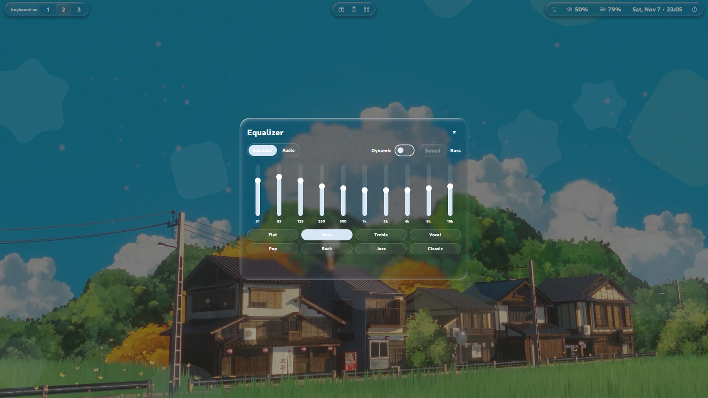

# Equalizer UI Patterns for LME Shell

This note records the Serpantinum-parity architecture of the equalizer feature
(re-implemented 2026-11-06; plan in issue #69).

## Attribution

The UI and state machine are adapted ports of Serpantinum Shell
(`ilyamiro/serpantinum` @ `2aa00c3`, AGPL-3.0-or-later):
`MusicEqView.qml`, `MusicAudioView.qml`, `MusicBottomHeader.qml`,
`MusicEqualizerState.qml`, `MusicPresetButton.qml`, `equalizer.sh` and the
`eq_lightning` shader. The file mapping and modification notes live in
`third_party/Serpantinum-NOTICE`.

## Runtime model

- The backend owns the state: `scripts/equalizer_actions.py` keeps an
  `eq_state` document (`XDG_STATE_HOME/lme-shell/equalizer.json`, atomic via
  `storage.py`), seeded from the daemon's 17-token `ctl get` report on first
  use and flat when the daemon is absent. This is the single apply contract
  for every surface (panel, Settings page, bar button, Control tile).
- `eqGet` returns the document and never probes the daemon, so it cannot fail
  on default installs and nothing emits an error toast at login. Surfaces call
  `EqualizerState.refresh()` only while visible.
- Band edits stage (`eqSetBand`: preset → Custom, pending → true) and commit
  with `eqApply`. Presets (`eqPreset`) and audio settings (`eqBalance`,
  `eqMono`, `eqSwap`, `eqDyneq`, `eqDynamics`, `eqReset`) push immediately.
  Every push sends the full state and retries once after `serpantinum-audio
  start` (upstream `audio_ctl` parity), so a stopped daemon never blocks the UI.
- `eqRevert` restores committed bands while keeping live values; the QML
  singleton reverts staged band edits when switching panel views (upstream
  `restoreLastSavedEqualizer` parity) and on push failures re-reads `eqGet`.
- `eqTest`/`eqTestStop` play a generated channel tone (L 660 Hz, R 880 Hz,
  both 770 Hz) through `pw-play`, targeting `serpantinum_sink` when present.

## QML structure

- `qml/services/EqualizerState.qml` (singleton): eqData/savedEqData, optimistic
  applies, the two-second local-write suppression window for `eqGet` results
  (an in-flight read can no longer overwrite a fresh apply), the lightning
  driver (`eqLightningProgress`/`eqLightningFade`) and the test-tone timer.
- `qml/components/EqualizerBands.qml`: ten vertical band sliders with animated
  value settle (400 ms OutQuart), hover/press handle scale, pop and release
  flash, per-band pulses (track pulse, glow ring, fill flash, handle halo) and
  the `eq-lightning.frag.qsb` strand behind them.
- `qml/components/EqualizerBalance.qml`: notch-scale balance card with
  center-origin fill, L/R percentages and the descriptive center label.
- `qml/components/EqualizerAudioControls.qml`: balance card plus mono/swap
  toggles and the Off/Balanced/Night segment; shared by panel and Settings.
- `qml/components/EqualizerPresets.qml`: 2×4 preset chips, active preset
  highlighted; `qml/components/SegmentSwitch.qml` is the animated pill control.
- `qml/panels/EqualizerPanel.qml`: header + toolbar (Equalizer/Audio tabs,
  Test, Dynamic toggle, Apply/Saved-Reset morph, preset label), sliding
  crossfaded views, staged intro animations (header → sliders → presets;
  audio rows), and the Dynamic EQ veil. The Dynamic toggle lives in the
  toolbar, outside the view it dims — it can always be switched off.
- `qml/settings/EqualizerPage.qml`: enable switch (preference + daemon
  start/stop), band/preset card, output card with test/reset, and Status.
- Demo mode: `handle()` publishes the generic demo preview, so surfaces keep
  their defaults (documented audit finding #66-4).
