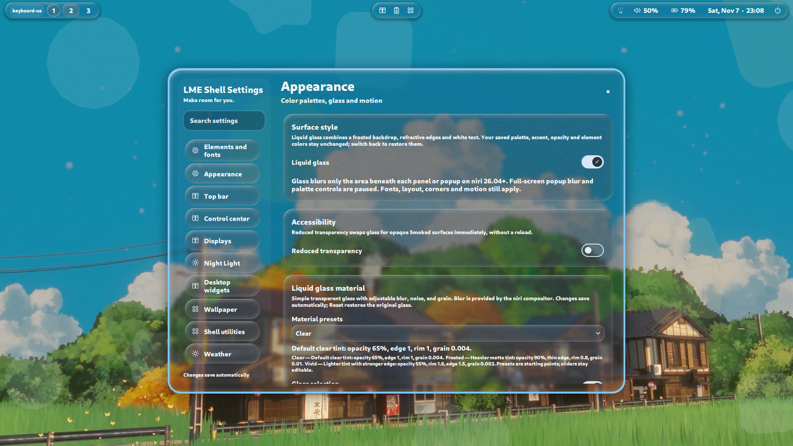

# Liquid Glass

How the shell's Liquid glass surface style works, how to tune it, and how to
fix common problems.

## Simple model (tint + grain + rim, compositor blur only)

Glass is a simple translucent surface drawn by the shell shader. It does **not**
read, sample, cache, or paint the desktop background or wallpaper.

Each glass surface renders only:
- a translucent tint layer (color from the panel tint, alpha governed by
  **Panel tint opacity**),
- procedural grain/noise, and
- a geometry-based edge highlight/rim.

**Blur comes only from the niri compositor.** The shell requests blur regions
for bar/popup/settings/notification/OSD/auth/desktop surfaces; niri blurs the
content behind those regions. The shell writes an owned snippet
`~/.config/lme-shell/liquid-blur.kdl` only when you click **Save niri blur
snippet**. The snippet uses `xray false` for the shell's blur regions and sets
`blur { passes, offset }`.

## Requirements & setup

- **niri ≥ 26.04** is required for compositor blur.
- Choose glass values, then click **Save niri blur snippet**. The shell refuses
  to overwrite a user-owned/non-marker file and refuses to write below 26.04.
- One-time setup: include `~/.config/lme-shell/liquid-blur.kdl` after
  `popup-blur.kdl` in your niri config (use your `XDG_CONFIG_HOME` path if
  customized), then run `niri validate`. Included files reload when applied.
- The status line shows `unsupported (niri < 26.04, detected <version>)`,
  `applied (niri blur snippet saved)`, or `pending (save snippet)`.

## Settings (Liquid glass material)

Settings → Appearance → **Liquid glass material** (visible in Liquid glass
mode). Presets are starting points, not modes: applying one writes the listed
glass values; sliders remain editable.

### Material presets

| Preset | tint | opacity | rim | edgeWidth | grain |
|---|---|---:|---:|---:|---:|
| Clear | `#f0081420` | 0.65 | 1.0 | 1.0 | 0.004 |
| Frosted | `#f0182436` | 0.90 | 0.8 | 0.5 | 0.010 |
| Vivid | `#f00a1a28` | 0.55 | 1.6 | 1.5 | 0.002 |

### Controls (real keys, from `config/liquid-glass.json`)

- `tint` (Panel tint, `#RRGGBB`/`#AARRGGBB`, default `#f0081420`).
- `opacity` (Panel tint opacity, 0.65, 0–1, 0.01): controls the tint layer
  alpha.
- `rim` (Edge highlight, 1, 0–2, 0.05).
- `edgeWidth` (Edge width, 1, 0.25–3, 0.05).
- `grain` (Grain, 0.004, 0–0.08, 0.001): procedural noise.
- `passes` (Blur passes, 2, 1–4, 1, compositor-wide): applies when the niri
  blur snippet is saved.
- `offset` (Blur spread, 3, 0.5–8, 0.5, compositor-wide): applies when the niri
  blur snippet is saved.

**Other:** `glassSelection` (Glass selection highlight, default on), **Pill
shadows** (Top Bar settings, `barPillShadow`, default on: soft drop shadow
around bar islands; the bar surface reserves padding for it — off removes
the shadow and the padding), **Selection accent** (Appearance → Accent
color, `accent`: the saved accent flows into Liquid glass selected
buttons/tabs, switch tracks, slider fills and notification accents; selected
fills pair with a luminance-derived label color so they stay readable on
light and dark glass),
**Reduced transparency** (Accessibility, swaps to opaque surfaces), **Reset
glass** (restores glass values; does not rewrite an already applied niri
snippet).

## Troubleshooting

- **No compositor blur.** Compositor blur needs niri ≥ 26.04 and an applied
  snippet. Click **Save niri blur snippet**, include
  `~/.config/lme-shell/liquid-blur.kdl` after `popup-blur.kdl`, run
  `niri validate`, and check `scripts/doctor.sh`.
- **Background too visible at low tint.** Raise **Panel tint opacity**, or
  increase compositor **Blur passes** / **Blur spread** after saving the niri
  blur snippet.
- **Glass off / opaque surfaces (by design).** Battery saver, **Reduced
  transparency** (Accessibility), software rendering, or `surfaceStyle = smoked`
  disable glass. Toggle Reduced transparency off or restore Liquid glass in
  Appearance.

## Attribution

The glass renderer adapts geometry/rim/grain ideas from
[Serpantinum](https://github.com/ilyamiro/serpantinum) (AGPL-3.0-or-later) by
Illia Miroshnichenko. Glass nesting adapts `glassNesting.js`; selection-lens
timing references `GlassLens.qml`. The former wallpaper-sampling lens,
snapshot backdrop, compositor-yield, and adaptive-contrast paths have been
removed. See [THIRD_PARTY.md](../THIRD_PARTY.md) and
[third_party/Serpantinum-NOTICE](../third_party/Serpantinum-NOTICE) for files,
revisions, modifications, and license terms.
