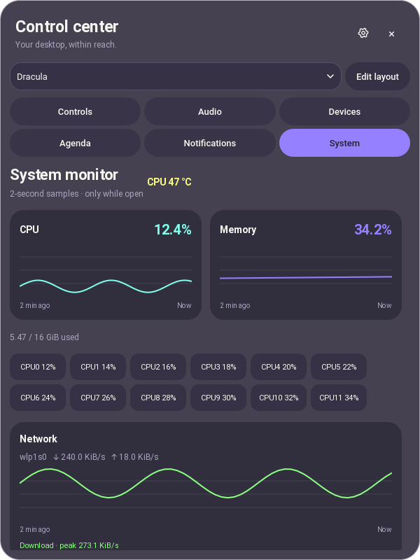
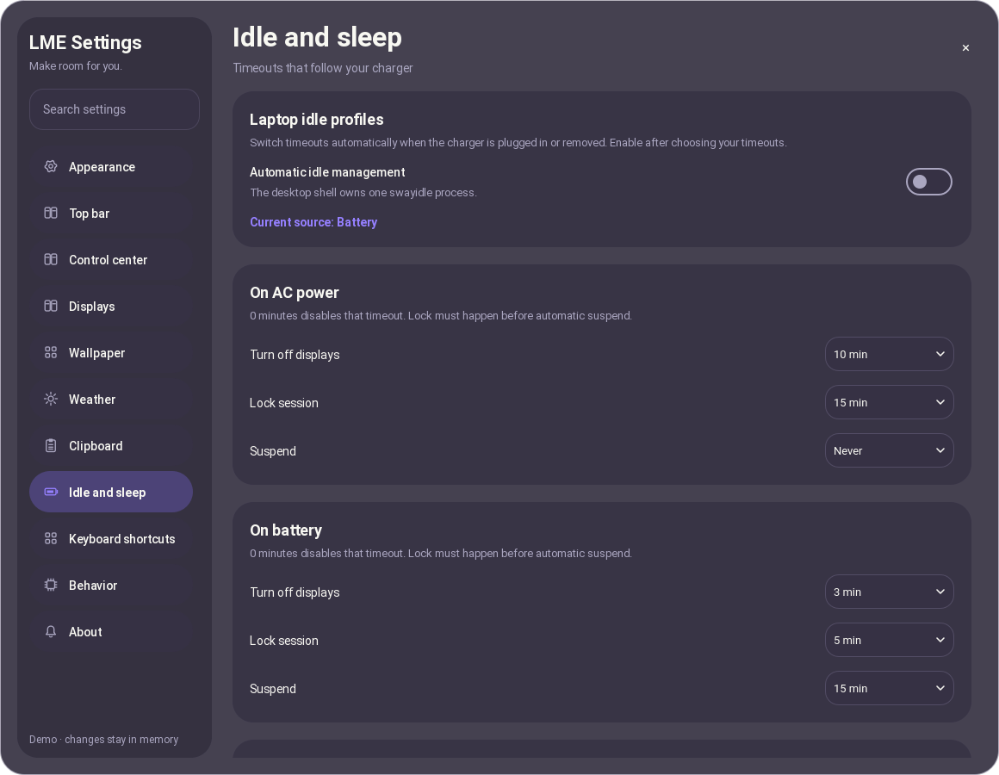
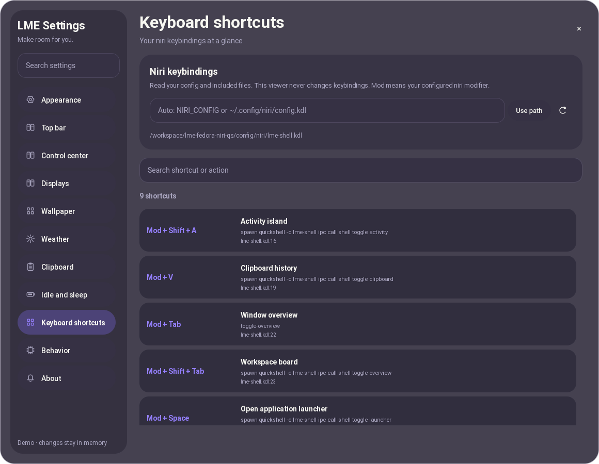

# System monitor, laptop idle profiles, keybindings and popup blur

These features keep the existing English Material/glass interface and Roboto typography. They use Python's standard library and the existing QML controls.

## System monitor — upgrade 12

Open **Control Center → System**, or the **System monitor** button in the resources card. CPU and memory charts retain the most recent 60 samples (about two minutes). CPU thread loads, CPU temperature, used/total memory, per-interface download/upload speeds, and searchable processes are available. Sort processes by CPU, memory or name. A process can exceed 100% CPU: 100% means one logical CPU thread. Memory is resident memory (RSS), rather than virtual address space.

Detailed `/proc` sampling runs only while this tab is open and stops when it is closed. The first interval shows `—` where a delta is not yet available. Counter resets, disappearing processes and reused PIDs are handled. Up to 4096 process directories are inspected per sample; kernel threads without resident memory are omitted. The download chart totals non-loopback interfaces; bridged traffic can appear on more than one interface, so use the individual rates for a particular connection.

CPU temperatures use the existing AMD/Intel CPU sensors. No NVIDIA command, GPU device, GPU telemetry or GPU sensor is queried. GPU monitoring is still a separate future feature.



## Laptop idle profiles — upgrade 8

Install the two existing optional desktop tools, then restart the shell:

```bash
sudo dnf install swayidle swaylock
```

Open **Settings → Idle and sleep**. Set independent AC/battery timeouts, then enable **Automatic idle management**. `0` / **Never** disables an individual timeout. Defaults are:

| Power source | Displays off | Lock | Suspend |
|---|---:|---:|---:|
| AC | 10 min | 15 min | Never |
| Battery | 3 min | 5 min | 15 min |

Management is initially disabled; saving a profile does not immediately suspend your laptop. The shell reads charger `online` state, rather than assuming a full battery is plugged in. It owns its swayidle child and restarts it when the source or profile changes. **Stay awake** pauses that child as well as requesting the existing Wayland idle inhibitor. Input/resume restores displays; disabling management or normal shell shutdown also restores displays.

**Lock before suspend** is on by default. Automatic suspend and the shell's power-menu suspend wait for swaylock's `--ready-fd` confirmation. A lock failure prevents those suspend requests and reports the error. Already confirmed, still-running lockers are reused. swayidle's `before-sleep` hook also requests locking for suspend initiated outside the shell, within logind's delay-inhibitor deadline; it cannot veto an external suspend if logind exhausts that deadline. Disabling the option permits suspend without this lock handshake.

A Linux parent-death signal also terminates swayidle if Quickshell kills its backend without normal cleanup. swayidle runs any pending display-resume command on termination. The confirmed session locker remains independent so stopping the shell does not unlock your session.

Remove a previous swayidle autostart before enabling this feature; the shell only stops processes it owns. Settings reads the running shell's idle status via IPC and displays startup/action errors. Without a running shell, Settings can still save profiles but does not start a second idle daemon. No root helper or password storage is needed for idle management.



## Keybinding viewer — upgrade 7

Open **Settings → Keyboard shortcuts**, or:

```bash
./scripts/settings.sh --page keybinds
```

The viewer reads `NIRI_CONFIG`, or `~/.config/niri/config.kdl` under your XDG config directory. If niri was launched with a custom `--config`, enter that path and select **Use path**. Search by shortcut, overlay title or action; **Refresh keybindings** reloads config changes. Each row shows its source filename and line. `Mod` remains your configured niri modifier.

The read-only parser follows relative/absolute includes, skips comments and `/-`-disabled nodes/properties, and handles quoted/raw strings, nested comments and braces inside strings. Include cycles are deduplicated. Missing/malformed included files report errors without discarding bindings in other files. Reads are bounded to 32 files, 12 include levels, 512 KiB per file and 2 MiB total. No keybinding or niri config is rewritten.

Advanced KDL v2 multiline strings and custom typed property values are outside this viewer's parser; use ordinary quoted/raw strings for binding descriptions. Editing bindings and detecting conflicts remain separate upgrades.



## Full-screen blur beneath shell popups

**Settings → Appearance → Blur behind popups** requests a full-screen blur region for the popup's screen. This includes the expanded Activity Island, Control Center, other shell panels and the authentication popup. Popup content stays sharp. Requests are released when the overlay closes; screenshot capture is not used and the clipboard is untouched.

This requires **official niri 26.04 or newer**, with `ext-background-effect-v1`, and Quickshell 0.3.2's Wayland background-effect support. Older niri builds retain the existing dim backdrop. This is compositor blur, not a claim that a dimmer blurs applications.

On supported niri, include/merge [config/niri/popup-blur.kdl](../config/niri/popup-blur.kdl). For the default installation, add this to your niri config:

```kdl
include "~/.config/quickshell/lme-shell/config/niri/popup-blur.kdl"
```

Use your installed directory instead if your config is named `gpt`. Only add this include on supported niri; older builds cannot parse these directives. If your config already contains a global `blur` block, merge its settings instead of adding another block. Run `niri validate` before applying the edited config.

The fragment sets `xray false` specifically for `lme-overlay` and `lme-authentication`, so application windows participate in blur; xray blur would use the wallpaper. It starts with two passes, offset 3 and no saturation boost for a moderate integrated-Radeon budget. niri describes non-xray blur as experimental: check its rendering and performance on your actual output. Increase passes only if your machine has room for the additional work. The shell does not change niri config automatically.

Upstream references: [niri blur configuration](https://github.com/YaLTeR/niri/blob/main/docs/wiki/Configuration%3A-Miscellaneous.md#blur), [layer background effects](https://github.com/YaLTeR/niri/blob/main/docs/wiki/Configuration%3A-Layer-Rules.md#background-effect). iNiR/DMS were workflow references; no implementation source was copied.

## Preferences and validation

`idleEnabled`, `idleProfiles`, `idleLockBeforeSleep`, `niriConfigPath` and `popupBlur` use the existing atomic shared preferences file. Detailed monitor history stays in memory. Demo previews simulate these features without changing hardware, preferences, the clipboard or the session lock.

Run `./scripts/check.sh` for backend contracts. On the private development Wayland session, add `LME_TEST_IDLE_NATIVE=1` for a real swayidle idle/resume test using a temporary fake niri command, and `LME_TEST_UPGRADE_UI=1` for actual System/Settings interactions. See [VALIDATION.md](VALIDATION.md) for the complete command and the target-machine limits.
