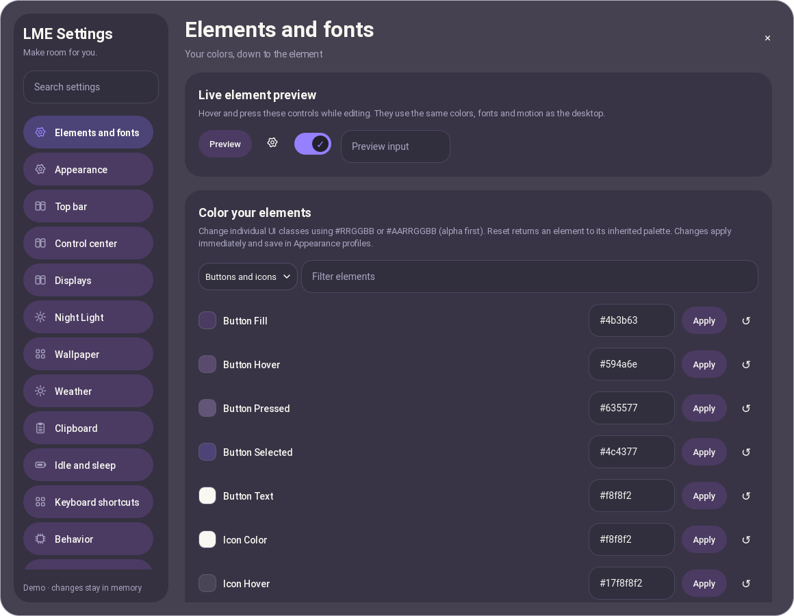
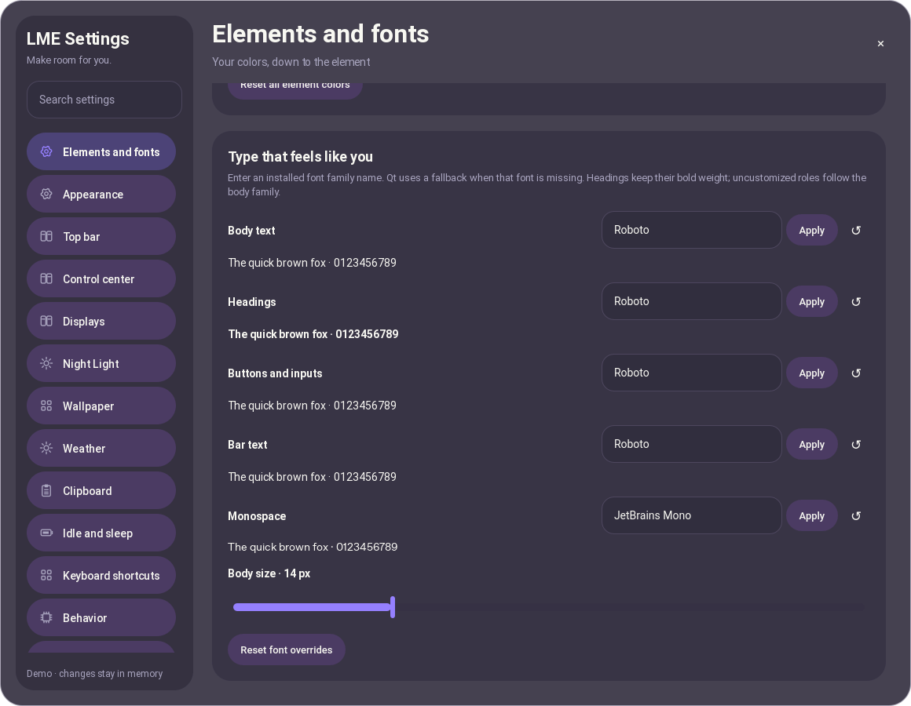
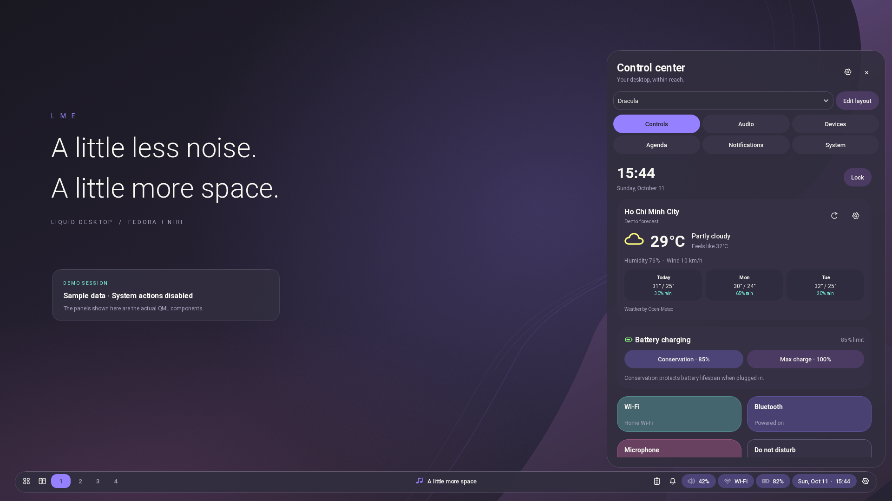

# Elements, typography and liquid motion

Open **Settings → Elements and fonts**, or run:

```bash
./scripts/settings.sh --page elements
```

The app works independently of the shell. Both `quickshell` and `qs` binary
names are supported. Opening Settings from a running shell reuses that shell's
binary and entry point, including a configuration installed as `gpt`. Repeated
opens reuse the existing Settings window; closing it with the window manager,
Escape or the close button ends that instance so it can be opened again.



## Colors and fonts

Choose a color group, optionally filter its elements, then enter a hex value
and press Enter or Apply. The live preview uses the desktop's actual controls.
There are 45 editable color roles across the palette, Material surfaces, buttons
and icons, inputs, bar and workspaces, and panels/cards. These are shared UI
classes: changing `buttonFill`, for example, changes ordinary buttons across
the shell. Purpose-specific selected/error states retain their semantic roles.

Use `#RRGGBB` or `#AARRGGBB`, with **alpha first**. Glass surfaces multiply that
alpha by the configured interface opacity. Invalid values show an error and do
not replace the last valid color. Reset removes an override and resumes the
inherited palette. Reset all element colors clears the overrides together.
`config/palette.json` remains the fallback palette; overrides live in the user's
`settings.json`, separate from the source checkout.

Font roles are Body text, Headings, Buttons and inputs, Bar text and Monospace.
Enter an installed font family name and press Enter or Apply. Uncustomized roles
inherit the body font, except Monospace, which defaults to JetBrains Mono.
Roboto remains the default. Bold headings keep their weight when their family
changes. Qt substitutes an available font if the requested family is missing;
install new fonts and restart the Quickshell instances to refresh Qt's font
database. Body size is adjustable from 12–20 px; bar size remains independently
adjustable from 12–16 px in the Top bar page.

Appearance profiles save these colors, font roles and body size alongside
accent, opacity, density and motion. Earlier saved profiles acquire the new
defaults automatically. Applying Dracula clears element/font overrides.



## Bar placement

**Settings → Top bar → Make room at the edge** controls:

| Preference | Range | Default |
|---|---|---|
| Screen edge | Top / Bottom | Top |
| Distance from edge | 0–64 px | 8 px |
| Side margins | 0–160 px | 12 px |
| Bar height | 36–64 px | 42 px |

The horizontal bar updates immediately on each output. Its reserved application
space follows the active edge. The Activity island, tray, side panels and
notification popups also follow that edge; centered dialogs remain centered.
Niri's own `layout.gaps` still contributes to the space around application
windows. Bar placement is a layout preference and is not changed by applying an
Appearance profile. Vertical bars and independent per-output offsets are not
implemented in this release.



## Motion

Smooth, Expressive and Jelly retain the speed/bounce controls in Appearance.
Buttons and icons now scale and morph their corners on hover/press. A bounded
flat ripple expands on press, holds while pressed and fades after release.
Workspace pills animate their active width. Settings pages enter with the shared
slide motion. Desktop panels retain their content during exit and support
reopening during that transition without snapping their position.

Spatial motion uses overshooting expressive curves; effects use a separate
non-overshooting curve. Turning Motion off stops these transitions and places
controls/panels immediately. Feedback has no continuously running idle animation
and adds no shader, font asset or runtime package. Native compositor blur remains
the existing niri 26.04 mechanism; it does not substitute the wallpaper for live
applications. See [upstream motion attribution](../THIRD_PARTY.md).

## Extending the theme

`config/theme-tokens.json` is the shared catalog read by the Settings UI and
backend validator. Add a role there, give it a fallback in `qml/theme/Theme.qml`,
then consume it in the appropriate shared component or panel. Keep derived
defaults in Theme rather than duplicating them in Settings. Font roles use the
same catalog and validation boundary.

Individual edits send `{action: "setting", key: "themeOverrides", token:
"buttonFill", value: "#113355"}` (or `fontOverrides`). An empty value resets
that token. The existing preferences lock reloads and merges the nested map
before the atomic write, preserving other clients' edits to different tokens.
Whole-map replacement remains available for Reset all. This reuses the existing
preferences/profile architecture instead of introducing a second theme store.


## Bar corners and border

**Settings → Top bar → Edges and outline** previews the actual bar surface.
Choose Pill, Square, Square left end or Square right end, then customize each
corner independently. Automatic roundness follows half the bar height; turn
Auto off to choose 0–32 px. Radii are capped at half the bar height when drawn.
Choose Connected bar, Left island, Center island or Right island in the surface selector. Each island has separate corners, fill and outline. Islands default to automatic pill corners and a 1 px outline; the connected bar keeps its own saved geometry. Switching modes preserves all four styles.

Outline thickness is 0–4 px; 0 removes the outline. Enter `#RRGGBB` or
`#AARRGGBB` for its color, use the visual picker, or Reset to inherit the palette.
The `barBorder` element is also available in Elements and fonts. Each island also accepts its own fill/border hex colors, including alpha. Reset this island removes only its overrides. Corner geometry, island colors
and thickness are included in portable presets/backups; the color remains part
of Appearance profiles through the existing element override system. Existing
settings retain the automatic pill shape and 1 px inherited outline.


## Built-in color palettes

Settings → Appearance → Color palettes offers LME Dracula plus all 35 theme
arrays currently registered in Gowall: Catppuccin Mocha/Frappe/Latte, Nord,
Everforest, Solarized, Gruvbox, Dracula, Tokyo Moon/Storm/Dark, One Dark, Srcery,
Monokai, Material, Synthwave 84, Atom Dark, Oceanic Next, Shades of Purple,
Arc Dark, Sunset Aurant/Saffron/Tangerine, Cyberpunk, Night Owl, GitHub Light,
Rose Pine, Kanagawa, Melange Dark/Light, Palenight and Ayu/Dark/Light/Mirage.

Search, inspect the preview, then Apply palette. Preview does not change your
current theme. Global element/font overrides and independent island overrides
remain; reset those overrides if you want the preset's complete appearance.
Save a named Appearance profile to keep the chosen preset with your motion,
opacity, typography and other appearance settings. Presets need no Gowall binary.

These are UI adaptations of image palettes, not exact terminal theme mappings.
Neutral surfaces are derived where missing and foregrounds are adjusted for
readability. Light variants include Catppuccin Latte, GitHub Light, Melange Light
and Ayu Light. LME Dracula remains the factory default. Gowall's README mentions
Sweet, but its registered theme table contains no Sweet palette at the inspected
revision; no unverified colors were invented for it.

## Material palette generation

Settings → Wallpaper keeps the isolated Matugen preview/apply workflow and adds
nine schemes, dark/light mode and contrast from -1 to 1. Choose an image, change
the options, generate a preview and Apply palette. Changing options invalidates
that preview; regenerate before applying. All base palette roles are covered,
including green/yellow, while manual overrides remain. Requires Matugen 3 or 4;
no templates, external app themes, wallpaper commands or user hooks are run.
Matugen 4 uses its highest-ranked source color automatically, so generation
works from Settings without a terminal or a color-selection prompt. Matugen 3
keeps its existing command format.
