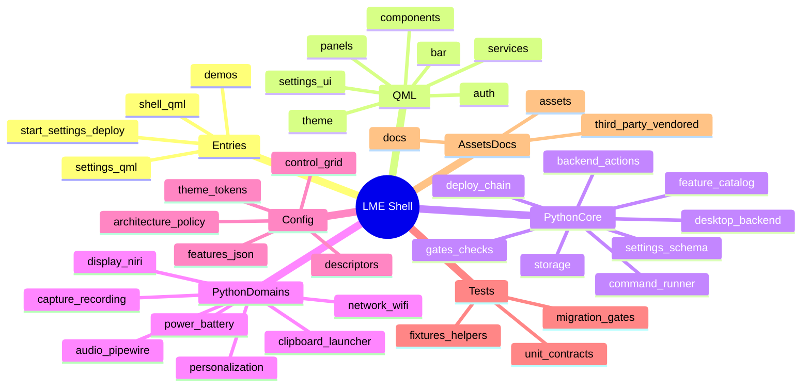
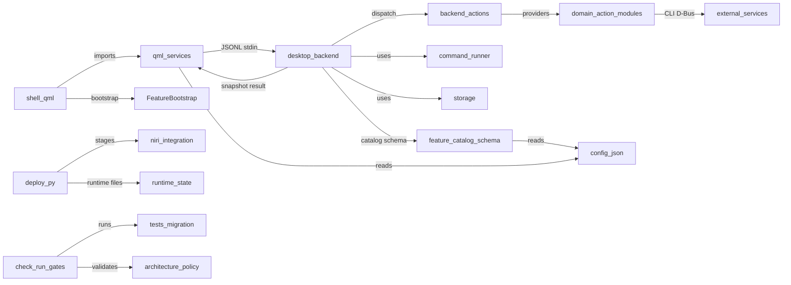

# Workspace Map — LME Shell (`lme-fedora-niri-qs`)

> Relationship layer on top of existing docs. Read with:
> - [`AGENTS.md`](../AGENTS.md) — working rules, layout/dependency rule, commands.
> - [`docs/ARCHITECTURE.md`](ARCHITECTURE.md) — contracts (catalog, action registry, settings schema).
> - [`docs/STATE.md`](STATE.md) — current status, adapters/retirement, gate rules.
> - [`docs/CONFIGURATION.md`](CONFIGURATION.md) — user-facing config details.

## 1. Header
| Field | Value | Evidence |
|---|---|---|
| Scanned baseline commit | `6c1dc3ce4ed34662a1cd68d70633ea7e3dbf81ee` (`main`) | `[verified]` Phase 0 survey |
| Annotation branch | `docs/annotate-and-map` (comments-only commits; no behavior change) | `[verified]` git history |
| Map date | 2026-11-09 | `[verified]` |
| Static graph tooling | `scripts/check_architecture.py` (stdlib, literals-only imports/URLs, nonblank size ratchet, informational language-mix counter since Q0) rerunnable via `python3 scripts/check_architecture.py`; Phase 1 graph built in a disposable temp dir (not committed) | `[verified]` `scripts/check_architecture.py:1-205`, `:158`, `:166-194` |
| Greppable tags | `REL:`, `INVARIANT:`, `GOTCHA:` — `grep -rn 'REL:\|INVARIANT:\|GOTCHA:' qml scripts tests *.qml` | `[verified]` Phase 2 tags |

## 2. Overview
`lme-fedora-niri-qs` is a Fedora + niri desktop shell: a Quickshell QML UI (`shell.qml`, `settings.qml`, demos) plus an unprivileged Python JSON-lines backend (`scripts/desktop_backend.py`) and domain/action modules. `[verified]`

Main layers: root entries → `qml/{bar,panels,components,services,settings,theme,auth}` (UI/service composition) → `scripts/` core infra (backend, action registry/providers, command runner, storage, catalog/schema, deploy/check gates) → `scripts/` domain families (audio/network/display/power/media/capture/personalization/etc.) → `config/*.json` (feature index, descriptors, layout/theme/preferences fragments) → `tests/` (contracts, fixtures, migration/gate checks). `[verified]` `config/architecture.json`, `AGENTS.md:23-43`

IPC boundary: QML `ShellState` spawns `desktop_backend.py` and exchanges JSON-lines requests/results over stdin/stdout; action dispatch uses `ActionRegistry`/providers with host-owned worker scheduling and completion publication. Since Q1, read-only state for audio/microphone/battery/power-profiles/bluetooth/network-summary is served natively (`AudioState`/`PowerState`/`BluetoothState.sectionFor`/`NetworkState` via `NativeState.merge` into `ShellState.system`, reference-stable through `SystemMerge.js`); since Q3 the write families route natively in real sessions through the family router in `ShellState.run` (`nativeOwner` fan-out to Network/Audio/Bluetooth/PowerState `canRoute`/`perform` with a context carrying the merged system, pending settled locally via `ActionPending.settled`): the six wifi action names (`NetworkState.perform`) plus the audio/backlight controls (`AudioState`, PwNodeAudioIface writes + brightnessctl Process), bluetooth radio/device writes (`BluetoothState`, adapter/device property writes) and chargeMode (`PowerState`, the pkexec helper argv) — with the registries as fallback (rfkill-blocked bluetooth enables use the backend's unblock path; no-native-backend sessions fall back for canonical errors); the backend still emits those sections and serves as fallback during the A/B window (`DEPRECATED(Q1->Q6)`/`DEPRECATED(Q3->Q6)` in `desktop_backend.py`). `[verified]` `qml/services/ShellState.qml:19,160-211`; `qml/services/NativeState.qml`; `scripts/desktop_backend.py:1122-1138`

Validation battery (read-only/isolated as used here): `python3 scripts/check_architecture.py`; `./scripts/check.sh`; `PYTHONPATH=scripts:tests python3 -m unittest discover -s tests -p 'test_*.py'` (AGENTS placeholder differs; `check.sh` uses `python3 -m unittest discover -s tests -v`); `./scripts/run-gates.sh --gates G0` (disposable XDG/Sway/D-Bus/qmllint). `[verified]` `AGENTS.md:60-72`, `scripts/check.sh`, `scripts/run-gates.sh:2-3,36-50,83`

## 3. Mermaid mindmap (module/function view)

`[verified]` module names reflect repo directories/files; mindmap is conceptual grouping.

## 4. Mermaid flowchart LR (module-level edges)

`[verified]` edges correspond to: `shell.qml:19`, `ShellState.qml:158,171,230`, `desktop_backend.py:553-554,1341-1342,1638`, `backend_actions.py`/providers, `command_runner.py`, `storage.py`, `feature_catalog.py`/`settings_schema.py`↔`config/*`, `deploy.py` chain, `check.sh`/`run-gates.sh`/`tests/migration_checks.py`.

## 5. Module index (module-level)
| Path/module | Role | Entrypoint(s) | Depends on | Depended by | Config/env involved | Evidence |
|---|---|---|---|---|---|---|
| Root entries | Live/demo/settings QML surfaces | `shell.qml`, `settings.qml`, `*-demo.qml` | `qml/services,theme,components,panels,auth` | user launch scripts, tests | `LME_SHELL_PREVIEW`, screenshot env, demo flags | `[verified]` `shell.qml:18-19,25-26`; `settings.qml` |
| `qml/bar/` | Bar modules/registry/gestures/surfaces | `Bar.qml`/`BarModule.qml`/registry | services, components, theme, catalog/control ids | `shell.qml`, panels | `config/control-grid.json`, bar prefs | `[verified]` `qml/bar/*`, `config/control-grid.json` |
| `qml/panels/` | Feature panels/islands/popups | panel components loaded by shell/catalog | services, components, theme | shell, bar, feature catalog | feature IDs, action names, prefs | `[verified]` `qml/panels/*`; `ControlDashboard.qml` anchors |
| `qml/components/` | Shared controls, motion, glass, shaders/helpers | reusable QML/JS components | theme, services (selective) | all QML layers (high fan-in) | theme tokens, liquid-glass config | `[verified]` graph fan-in: `LabelText.qml`, `LiquidButton.qml`; Phase 2 skips vendored shapes/shaders noted |
| `qml/services/` | Singletons/state bridges (backend, catalog, notifications, clipboard, media, native state, etc.) | `ShellState.qml`, `FeatureCatalog.qml`, `NativeState.qml`+`AudioState`/`PowerState`/`BluetoothState`/`NetworkState` (Q1 native sections), `LauncherState`+`MonitorState` (Q2 native files), `NetworkState` wifi lists/actions + `AudioState`/`BluetoothState`/`PowerState` write legs (Q3 family router) + `AudioDeviceState`/`NetworkInventoryState` inventory legs with `CommandRunner.qml`/`Digest.js`/`AudioDeviceModel.js`/`NetworkModel.js`/`NetworkPlans.js` (Q3 final leg) + `WindowState`/`NiriState`/`NiriIpc`/`KeybindsState` with `NiriModel.js`/`KeybindsKdl.js`/`KeybindsModel.js` (Q4 session families — niri IPC over `Quickshell.Io.Socket`), workers | Quickshell Io/Services (Pipewire/UPower/Bluetooth/Networking since Q1; DesktopEntries/FileView since Q2; one-shot Processes since Q3), config, Python workers | bar/panels/settings/components | `config/features.json`, `control-grid.json`, backend protocol, MPRIS/niri/env | `[verified]` `ShellState.qml:19,158,171`; `qml/services/NativeState.qml:26-40`; `FeatureCatalog.qml:154` |
| `qml/settings/` | Settings host/pages/registry/cards | `settings.qml`, `SettingsApplication/View/Registry` | services, components, catalog | settings app, page CLI | page IDs, `legacyIndex`, prefs schema | `[verified]` `SettingsView.qml:3`, `SettingsRegistry.qml` REL tags |
| `qml/theme/` | Theme tokens/roles | `Theme.qml`, `qmldir` | services prefs/config | all QML | theme/palette/glass config | `[verified]` fan-in 115; `Theme.qml` headroom 0 |
| `qml/auth/` | Authentication agent/dialog/window | `AuthenticationAgent.qml` | services, components | shell live session | demo/session guards | `[verified]` `shell.qml:22` |
| `scripts/` core backend | Request loop, snapshot, feature jobs, legacy routing | `desktop_backend.py` | action_pending, backend_actions, command_runner, storage, domain modules | QML ShellState, tests | `NIRI_SOCKET`, XDG, settings files | `[verified]` `desktop_backend.py:34,504,553,1172,1182,1341,1638,1679` |
| `scripts/` action/registry | ActionSpec registry, provider resolution, pending protocol | `backend_actions.py`, `backend_providers.py`, `action_pending.py` | feature_catalog/provider modules | desktop_backend, action modules, tests | action IDs, contexts, sequence/pending | `[verified]` `backend_actions.py:13-75`; `action_pending.py` |
| `scripts/` runtime infra | Command execution, managed processes, output/storage | `command_runner.py`, `managed_command.py`, `command_output.py`, `storage.py` | stdlib, env, filesystem | backend and domain modules | PATH, `LME_QS_BINARY`, XDG, tool whitelist | `[verified]` `command_runner.py`, `storage.py` INVARIANTs |
| `scripts/` catalog/schema | Feature catalog + settings schema/metadata | `feature_catalog.py`, `settings_schema.py`, `catalog_metadata.py` | `config/features.json`, descriptors, legacy prefs | backend, QML catalog, checks/tests | feature IDs, prefs keys, control-grid refs | `[verified]` `scripts/feature_catalog.py:121`; `settings_schema.py` |
| `scripts/` deploy chain | Plan/apply/rollback, runtime/files/niri stages | `deploy.py`, `deploy_*.py` | filesystem, niri config, runtime probes | `deploy.sh`, operator | XDG, `NIRI_*`, `WAYLAND_DISPLAY` | `[verified]` `deploy.py:3-6`; `deploy_state.py:4`; `deploy_niri.py:4` |
| `scripts/` checks/gates | Architecture checks (ownership/cycles/sizes + informational language mix), fast checks, isolated gates | `check_architecture.py`, `check.sh`, `run-gates.sh` | config/architecture (incl. `toolingFiles` classification), tests | CI-local workflow, developers/agents | gate env isolation vars | `[verified]` `check_architecture.py:158,166-194`; `run-gates.sh:36-50,83` |
| `scripts/` domain families | Audio, network/wifi, display/mirroring, power/battery, capture/recording, clipboard, launcher, wallpaper/personalization, etc. | `*_actions.py` + domain libs | command_runner/storage/backend_actions, external CLIs/D-Bus | backend, QML panels/services | domain config/env/XDG paths, service CLIs | `[verified]` `scripts/*_actions.py` providers; Phase 1 external services |
| `tests/` | Unit/contract suites, helpers/fixtures, migration checks | `test_*.py`, fixtures, `migration_checks.py` | scripts modules, QML/native harness where gated | `check.sh`, `run-gates.sh`, developers | disposable session env for native/gates | `[verified]` test headers/REL tags; `run-gates.sh:83` |
| `config/` | Static config, descriptors, policy, tokens | `features.json`, `architecture.json`, `control-grid.json`, `*.json` | referenced by catalog/schema/QML/scripts | runtime/UI/schema/checks | feature IDs, prefs, layout, theme | `[verified]` JSON-descriptor edges; readers in catalog/schema/QML |
| `assets/` | Wallpapers, emoji/assets | static files | — | UI/docs | — | `[inferred]` asset role from tree; not code-analyzed |
| `third_party/` (if present in source refs) / vendored notices | Vendored/adapted third-party material | `THIRD_PARTY.md`, `third_party/*`, vendored shapes/shaders/components | upstream licenses | attribution/compliance; do not touch vendored code | license notices | `[verified]` `THIRD_PARTY.md`; Phase 2 skip reasons |
| `docs/` | Human/agent docs, plans, previews, state | `STATE.md`, `ARCHITECTURE.md`, etc. | repo reality | operators/agents | — | `[verified]` docs inventory |

## 6. Main flows (verified step anchors)

### (a) Shell startup
1. `shell.qml:18` — reads preview flag from env (`scripts/start.sh --preview` path) `[verified]`
2. `shell.qml:19` — mounts `FeatureBootstrap` for catalog/bootstrap init `[verified]`
3. `shell.qml:22` — auth agent enabled only for live session (not demo) `[verified]`
4. `shell.qml:25-26` — exposes IPC target `shell` (`toggle/close/restartBackend/...`) `[verified]`
5. `qml/services/ShellState.qml:230` — creates long-lived backend `Process` (`scripts/desktop_backend.py`) `[verified]`
6. `qml/services/ShellState.qml:158,171` — `run(action,payload)` serializes JSON-lines requests to backend stdin `[verified]`
7. `qml/services/FeatureCatalog.qml:154` + `qml/services/ControlRegistry.qml:26` — load `config/features.json` / `config/control-grid.json` for projections `[verified]`
8. `scripts/desktop_backend.py:553-554` — constructs `ActionRegistry` and provider state/capabilities `[verified]`
9. `scripts/desktop_backend.py:1638,1679` — main selector loop reads stdin JSON-lines and dispatches via `handle_line`/`handle` `[inferred]` exact startup emission sequencing beyond anchors; `:504` emits snapshots.

### (b) Action round-trip UI → backend → UI
1. `qml/services/ShellState.qml:158` — UI/service calls `run(action,payload)` `[verified]`
2. `qml/services/ShellState.qml:171` — writes JSON line `{action,...}` (includes client serial/pending handling) `[verified]`
3. `scripts/desktop_backend.py:1679` — selector loop receives stdin line; `action_pending.handle_line` parses/validates JSON `[verified]`
4. `scripts/desktop_backend.py:1341-1342` — `handle()` acknowledges client serial, increments `result_sequence`, dispatches by context `[verified]`
5. `scripts/backend_actions.py:54-75` — `ActionRegistry.dispatch/invoke_live` checks context, selects demo/live, starts worker via host `start_feature` when needed `[verified]`
6. `scripts/desktop_backend.py:1172` — host admits worker jobs in `feature_jobs`/executor (worker admission owned by backend) `[verified]`
7. `scripts/desktop_backend.py:1182,1194,1197,1209,1365` — completion/result publication builds `lastResult` (`ok,action,message,sequence`, optional `pending`) one completion at a time `[verified]`
8. `scripts/desktop_backend.py:504` and loop emits snapshot/result projection via `action_pending.emit/publish` `[verified]`
9. `qml/services/ShellState.qml:182,219-225` — consumes `actionPending`/`lastResult`, reconciles ownership, updates status/UI state `[verified]`

### (c) Feature catalog registration/loading
1. `config/features.json` — canonical bundled feature index/descriptors `[verified] `qml/services/FeatureCatalog.qml:154`, `scripts/feature_catalog.py:121`
2. `scripts/feature_catalog.py:121` (and related validation) — reads/validates index+descriptor resources; projects kinds/ids/preferences metadata `[verified]`
3. `scripts/settings_schema.py` — merges descriptor preference metadata with legacy fragment for defaults/validation metadata `[verified]` module header
4. `qml/services/FeatureCatalog.qml:154` — QML singleton loads catalog path and publishes projections (bar/settings/control/tab/bootstrap metadata) `[verified]`
5. `qml/services/ControlRegistry.qml:26` — loads `config/control-grid.json`; maintains tab/card IDs and `legacyIndex` compatibility `[verified]` `:21-26`
6. `scripts/check_architecture.py` owners/graph checks — enforce declared ownership/shared/host roles and size/exception policy, and print the informational language-mix trend (Q0, docs/QML_FIRST_MIGRATION_PLAN.md §1) `[verified]` `scripts/check_architecture.py:92-162,185-205`

### (d) Settings open + page navigation
1. `settings.qml` / `qml/settings/SettingsApplication.qml` — standalone Settings entry/host composition `[verified]` files exist; `SettingsApplication.qml` header REL
2. `qml/settings/SettingsView.qml:3` — INVARIANT: page IDs/`legacyIndex` routes remain compatible with CLI/catalog `[verified]`
3. `qml/settings/SettingsRegistry.qml` — resolves settings page IDs/entries from catalog projections `[verified]` header REL
4. `qml/components/PageNavigation.qml` — local `navigateRequested(pageId)` bridge (no global bus) `[verified]` Phase 2 header
5. `scripts/settings.sh` launches settings (page arg support) `[verified]` `scripts/settings.sh` header/usage
6. Persistence flows through backend/settings actions and `storage.py` atomic writes with stable flat preference keys `[verified]` `storage.py` INVARIANT; `desktop_backend.py` Preferences paths

### (e) Prewarm/warm-render / motion lifecycle (partial)
1. `qml/components/SlideLoader.qml`, popup/motion components (`MotionPopup.qml`, `MotionAnimation.qml`, `SpringMotion.qml` vendored/adapted) participate in staged UI motion `[inferred]` specific prewarm contract lines not fully traced in this pass; see component headers and `docs/STATE.md`/recent commit context if needed.
2. Recent island/warm-render behavior is referenced by commit history; map records this as a candidate flow only where directly evidenced `[inferred]` needs targeted Phase 3 follow-up if owners require step-level detail.

### (f) Clipboard capture/activity
1. `qml/services/ClipboardState.qml` — main-shell-scoped worker state/protocol; Settings/demo must not start capture worker `[verified]` header INVARIANT
2. `scripts/clipboard.py` — spawned JSON-lines worker; bounded local history; XDG state/config paths, `CLIPBOARD_STATE` guard `[verified]` `scripts/clipboard.py:1-12,159,230` trailing tags
3. Clipboard UI surfaces (`qml/bar/ClipboardButton.qml`, `qml/panels/ClipboardPanel.qml`, settings page) consume state and actions `[verified]` Phase 2 headers
4. Image annotation/capture is a separate capture/backend path, not the clipboard worker `[verified]` `docs/ARCHITECTURE.md` contract; `scripts/capture_actions.py`/`screen_capture.py`

## 7. "If you change X, check Y"
| Change X | Check Y | Why | Evidence |
|---|---|---|---|
| JSON-lines protocol fields (`action,ok,message,sequence,pending`, `actionPending`/client serial) | `qml/services/ShellState.qml::run`, `scripts/action_pending.py::*`, `scripts/desktop_backend.py::handle/emit/finish_features`, provider result shapes | UI/backend ownership and completion delivery depend on stable envelope semantics | `[verified]` `ShellState.qml:158,171,182`; `desktop_backend.py:504,1182,1194,1209,1341-1342,1365,1679`; `backend_actions.py` |
| Action ID strings / `ActionSpec` names | `scripts/*_actions.py::provide`, `backend_actions.py::ActionRegistry`, `desktop_backend.py` legacy routing, QML `ShellState.run(...)` callsites | String-keyed dispatch couples UI/providers/backend; static graph does not capture it | `[verified]` `wifi_actions.py`, `lock_actions.py`, `saver_actions.py`, panel REL tags |
| Feature IDs / descriptor paths / catalog projections | `config/features.json`, descriptors, `scripts/feature_catalog.py`, `qml/services/FeatureCatalog.qml`, `check_architecture.py` ownership/policy | Registration, UI injection, schema discovery, and ownership checks share IDs/paths | `[verified]` `FeatureCatalog.qml:2`; `scripts/feature_catalog.py:121`; `config/architecture.json` |
| Settings keys / preference metadata / defaults | `config/*` `"preferences"` blocks, `config/preferences-legacy.json`, `scripts/settings_schema.py`, `desktop_backend.py` Preferences, QML `ShellState.preferences.*` | Validation/defaults/portability and UI bindings must agree; schema bindings are Python-owned | `[verified]` `settings_schema.py` INVARIANT; `storage.py` semantics |
| Control/grid/tab IDs and `legacyIndex` routing | `config/control-grid.json`, `qml/services/ControlRegistry.qml`, `qml/settings/SettingsView.qml`, panels/tabs, catalog projections | Layout, tab selection, and legacy routes are cross-file ID vocabularies | `[verified]` `ControlRegistry.qml:2-3,21-26`; `SettingsView.qml:3` |
| Jelly/popup mesh coupling | `qml/components/JellyGeometry.js::vertex`, `qml/components/shaders/popup-jelly.vert/.frag` (+ `.qsb` generated, do not edit) | Vertex layout/mesh size must match shader inputs | `[verified]` `JellyGeometry.js`, `popup-jelly.vert:3-4` |
| Atomic write/lock/fsync semantics | `scripts/storage.py::write_json/locked/fsync_directory` and all persistence callers | AGENTS owner constraint; corruption/loss prevention for settings/state files | `[verified]` `storage.py` module INVARIANT |
| Deploy/niri safety chain | `deploy.py` → `deploy_runtime/files/niri/niri_tree/state` | Apply requires backup, staged validation, diff, rollback path; planning is non-executing | `[verified]` `deploy_niri.py:4`; `deploy_state.py:4`; `deploy_niri_tree.py` header |
| Source-size ratchet (`largeFiles` ceilings) | `config/architecture.json::largeFiles`, `scripts/check_architecture.py:158-161` | Nonblank count includes comments; headroom-0 files cannot gain lines | `[verified]` `check_architecture.py:6,158-161` |
| External tool whitelist / availability contracts | `scripts/command_runner.py` TOOLS, domain modules, doctor checks, descriptor/tool expectations | Missing/renamed CLIs affect feature availability and error handling; no shell interpolation | `[verified]` `command_runner.py` header; Phase 1 service table |

## 8. Config & env (important subset)
| Name | Defined in | Used by | Default / fallback | Purpose | Evidence |
|---|---|---|---|---|---|
| `config/features.json` | repo config | `feature_catalog.py`, `FeatureCatalog.qml`, `check_architecture.py`, schema/catalog flows | bundled file | Canonical feature index/descriptors/registrations | `[verified]` |
| `config/architecture.json` | repo config | `check_architecture.py`, policy tooling | bundled file | Ownership/shared/hosts, dependency/cycle exceptions, `largeFiles` ceilings, `toolingFiles` line classification (Q0 language mix) | `[verified]` |
| `config/control-grid.json` | repo config | `ControlRegistry.qml`, `feature_catalog.py` | bundled file | Control cards/tabs/layout metadata, legacyIndex-compatible projections | `[verified]` |
| `config/preferences-legacy.json` + descriptor `"preferences"` | repo config | `settings_schema.py`, backend validation/defaults | bundled fragments | Legacy/default preference metadata bridge (Python-bound validators/resolvers) | `[verified]` |
| `config/{theme-tokens,palettes,liquid-glass,wallpaper,...}.json` | repo config | theme/services/actions/domain modules | bundled files | Visual tokens, palettes, glass, feature/domain settings metadata | `[inferred]` exact per-file consumer map varies; static json edges exist |
| `NIRI_SOCKET` | runtime env | `desktop_backend.py`, `niri_events.py` usage, `battery_saver.py`, `display_control.py`, `NiriState.qml`/`NiriIpc.qml` (Q4 native IPC), deploy/run gates | session-provided | niri IPC socket/session identity; preview/journal scoping; event stream + native request client | `[verified]` Phase 1/headers; `qml/services/NiriIpc.qml` |
| `XDG_CONFIG_HOME` / settings paths | runtime env | backend Preferences, clipboard, niri config lookup, start scripts | `~/.config` | `lme-shell/settings.json`, notification history, niri config paths | `[verified]` Phase 1 table |
| `XDG_STATE_HOME` / `XDG_CACHE_HOME` / `XDG_DATA_HOME` / `XDG_RUNTIME_DIR` | runtime env | backend/stateful features, launchpad/launcher/clipboard, caches, captures/runtime files | XDG defaults | Mutable state, caches, user data, runtime sockets/captures | `[verified]` Phase 1 table (grouped) |
| `WAYLAND_DISPLAY` / `DBUS_SESSION_BUS_ADDRESS` | runtime env | deploy/runtime probes, session checks; stripped/isolated for probes/gates | session-provided | Wayland/D-Bus session identity and isolation | `[verified]` deploy_runtime/run-gates |
| `LME_SHELL_PREVIEW` | runtime env | `shell.qml:18` | unset/`0` | Preview mode UI behavior | `[verified]` |
| `LME_QS_BINARY` | runtime env | `command_runner.py`, deploy/memory workload | `quickshell`/`qs`/managed | Quickshell binary selection | `[verified]` |
| `LME_SHELL_ENTRY`, `LME_NO_WALLPAPER`, `CLIPBOARD_STATE` | runtime env | backend/clipboard flows | feature-specific defaults | Shell entry override, wallpaper skip, clipboard worker state guard | `[verified]` Phase 1 table |
| Locale/PATH/git askpass vars (`LC_*`, `LANG`, `PATH`, `GIT_*ASKPASS`) | runtime env | `desktop_backend.py`, `command_runner.py`, `shell_update.py` | system/env defaults | Locale detection/deterministic output, tool resolution, noninteractive git | `[verified]` grouped |

## 9. Glossary
| Term | Meaning | Evidence |
|---|---|---|
| JSON-lines protocol | One JSON object per line over backend stdin/stdout; requests carry `action` (+ payload/client serial), replies/snapshots carry `ok/action/message/sequence` and pending/ownership metadata | `[verified]` `ShellState.qml:171`; `desktop_backend.py:1341-1342,1679` |
| ActionSpec | Backend action descriptor (`name,contexts,live,demo,execution,complete,presentation,prepare`) registered by providers | `[verified]` `backend_actions.py:13-26` |
| Provider | Factory/capabilities bundle supplying `ActionSpec`s and optional projection to `ActionRegistry.provide()` | `[verified]` `backend_actions.py:46-52`, `backend_providers.py` |
| Descriptor | Per-feature/config JSON describing sources, entries, preferences, worker/backend metadata | `[verified]` `config/features.json` refs, `feature_catalog.py` |
| Feature catalog | Bundled index + descriptor projections used by Python/QML registries and schema | `[verified]` `qml/services/FeatureCatalog.qml:154`, `feature_catalog.py` |
| Control grid | `config/control-grid.json` card/tab/layout metadata consumed by `ControlRegistry` and UI | `[verified]` `ControlRegistry.qml:26` |
| `legacyIndex` | Compatibility integer route/index for tabs/controls/pages where preserved | `[verified]` `ControlRegistry.qml:21-26`, `SettingsView.qml:3` |
| Park/dormant | UI/resource state where inactive surfaces release work while preserving recoverable state | `[inferred]` term used in repo context; component-specific contracts vary |
| keepAlive | Loader/surface retention hint preventing premature teardown during active/animated use | `[inferred]` common pattern; verify per component when changing loaders |
| Prewarm/warm-render | Early render/setup pass to reduce first-open jank; candidate flow, not fully step-mapped here | `[inferred]` |
| Gates G0–G6 | Isolated migration/native checks (`run-gates.sh`/`tests/migration_checks.py`); G0 is fast isolated baseline in this pass | `[verified]` `run-gates.sh`, `AGENTS.md` |
| Ratchet / `largeFiles` ceiling | Architecture policy: nonblank source lines (including comments) must not exceed recorded caps; shrink-only ratchet when lowering | `[verified]` `check_architecture.py:158-161` |
| Hosts | Composition roots allowed to load/coordinate feature entries across boundaries | `[verified]` `config/architecture.json::hosts` concept |
| Shared prefix/file rule | Shared `qml/components,theme,services`/declared shared files are cross-cutting dependencies; feature implementations must not import other feature implementations | `[verified]` `AGENTS.md:34-36`, `architecture.json` |

## 10. Findings (record only; not fixed)
| Finding | Location | Notes |
|---|---|---|
| G0 baseline incomplete/environmental in Phase 0 | Phase 0 baseline logs (disposable temp, not committed): `baseline-g0` ended mid-test, no summary | Log ended mid-test, no final summary; excluded from baseline comparison `[verified]` Phase 0 report |
| Headroom-0 files could not receive normal header/doc lines (trailing-only or existing-doc preserved) | `shell.qml`, `qml/services/ShellState.qml`, `qml/components/EqualizerBands.qml`, `qml/components/shaders/liquid-glass.frag`, `qml/components/shapes/shapes/{cubic,rounded-polygon}.js`, `qml/panels/{ControlDashboard,EqualizerPanel}.qml`, `qml/settings/{BehaviorPage,TopBarPage}.qml`, `qml/theme/Theme.qml`, `scripts/{battery_saver,bluetooth_agent,clipboard,desktop_backend,equalizer_actions}.py`, 18 headroom-0 test files | Size ratchet includes comments `[verified]` `check_architecture.py:158`; `phase2-log.md` |
| Test REL tags are heuristic/import-based | `tests/*.py` batch 5 annotations | Indicative, not exhaustive call-graph proof `[verified]` batch 5 reports |
| String-keyed action/protocol coupling not captured by static imports | `ShellState.qml:158,171`, `desktop_backend.py:1341+`, `scripts/*_actions.py` | REL tags and Phase 1/7 mitigate; grep for action IDs when changing `[verified]` |
| Computed imports/URLs not fully resolved by static scanner | `scripts/check_architecture.py:39-80` behavior | Manual review required for dynamic paths `[verified]` AGENTS note |
| Ephemeral build-artifact paths were removed from repo comments; docstrings now reference `docs/WORKSPACE_MAP.md`/config | scripts cleanup in Phase 2 | Avoid temporary local build paths in committed source `[verified]` batch 5a |
| Stale/incorrect old comments observed during Phase 2 | not exhaustively cataloged (rule: preserve old comments) | Any mismatches should be added as Findings when found with `file:line` `[inferred]` limited scan beyond touched areas |
| `__pycache__`/generated artifacts exist in worktrees generally | `tests/__pycache__/*` (not committed) | Do not commit; excluded from audits `[verified]` git hygiene |
| Intermittent `SettingsStartup` full-suite failure (environmental/timing) | `tests/test_settings_startup.py:153` (`SettingsStartupCase.test_backend_reconnect_keeps_the_loaded_window_and_theme`, asserts `result['disconnected']`) | Passes isolated (3x). Baseline `6c1dc3c` full rerun: `Ran 1073 tests in 182.472s` / `FAILED (failures=1, skipped=185)`. HEAD `e8cd117` full rerun: `Ran 1073 tests in 182.876s` / `OK (skipped=185)`. Evidence in disposable Phase 4b verifier logs (not committed). Not caused by comment/doc diff `[verified]` Phase 4b. |

## 11. Open questions / [inferred] items
| Item | Why uncertain | Needs owner confirmation? |
|---|---|---|
| Full prewarm/warm-render/island step-level flow | Not fully traced to file:line chain in this pass | Only if detailed map required `[inferred]` |
| Exact per-descriptor consumer list for every `config/*.json` | Static json edges + runtime composition vary by feature | Use `rg` per file when changing `[inferred]` |
| `managed_command.py`/supervision deep call graph | Header/usage documented; not fully step-mapped | Optional deep dive `[inferred]` |
| G0 environmental incompleteness root cause | Disposable gate log ended mid-test in this environment | Re-run G0 in target environment before relying on it `[inferred]` |
| Physical/hardware-only feature checks (audio headset, NM hotspot, etc.) | Explicitly out of scope for this read-only pass | Owner/real-session validation `[verified]` STATE/AGENTS policy |

---
*This map is a static relationship aid. Re-verify dynamic behavior and line numbers after further edits; rerun `python3 scripts/check_architecture.py` and relevant gates for behavior-affecting changes.*
